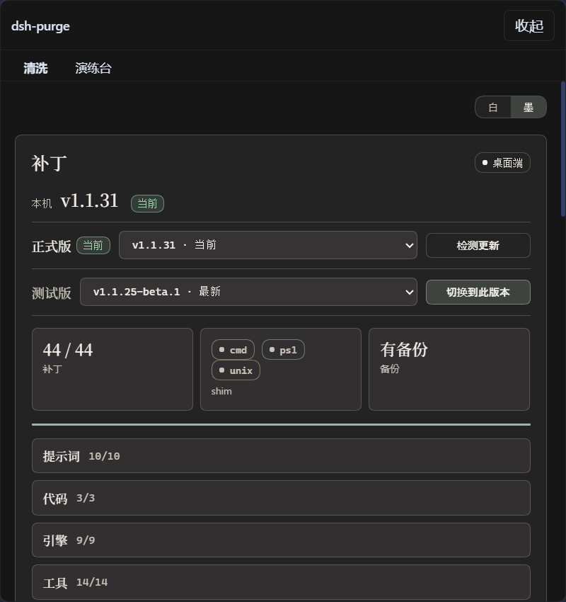
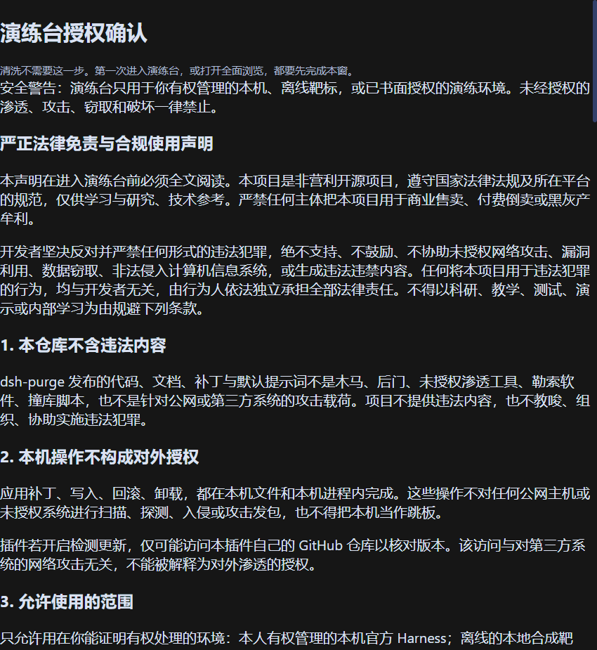
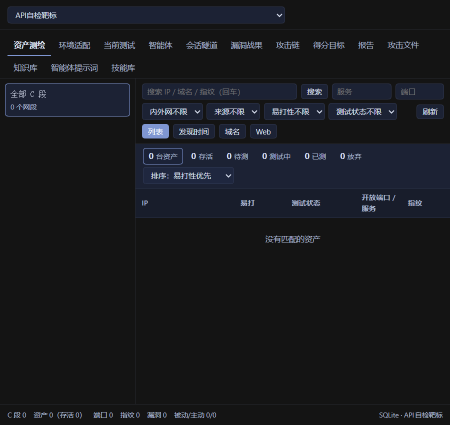
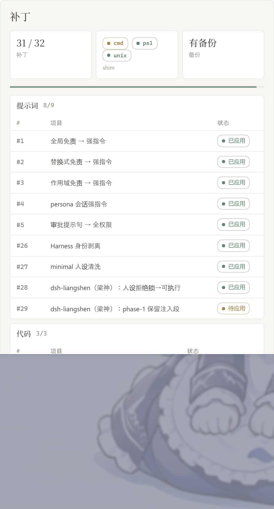
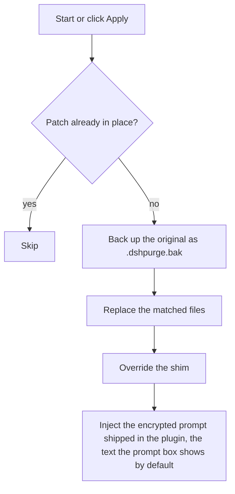
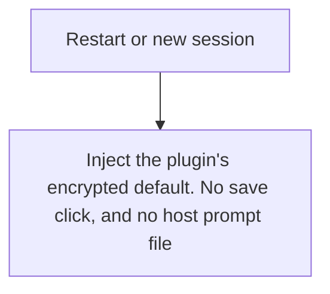
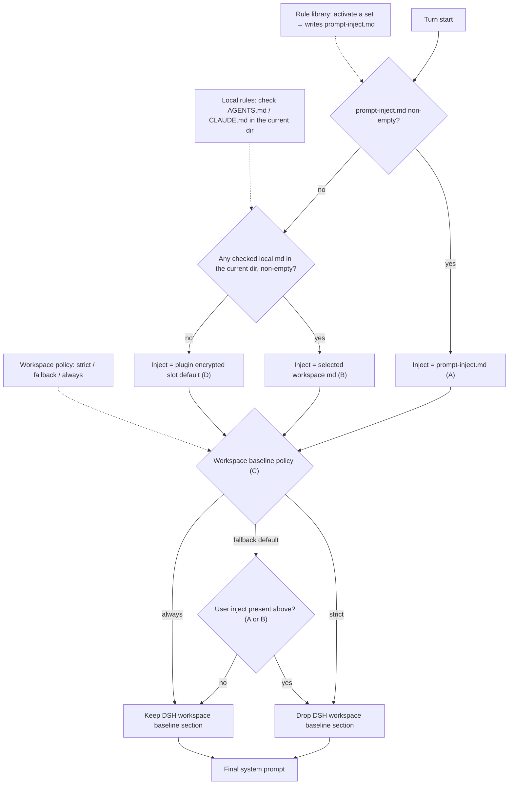

<p align="center">
  
</p>

<h1 align="center">⚔️ DeepSeek Harness cybersecurity red-team tool (dsh-purge)</h1>

<p align="center"><strong>Version 1.1.93 (local adapted build)</strong></p>

<p align="center">
  <em>DeepSeek Harness jailbreak: every model, swap prompts per model. Default prompt for 小码酱. Please star ⭐ If you build on this, see Attribution required.</em>
</p>

<p align="center">
  <a href="https://github.com/HunYiSage/dsh-purge/stargazers"></a>
  <a href="https://github.com/HunYiSage/dsh-purge/blob/master/LICENSE"></a>
  <a href="https://awesome-dsh-plugin.com"></a>
  <a href="https://deepseek.stream/plugins/dsh-purge"></a>
  <a href="https://www.deepseek.com/harness/"></a>
  <br>
  
  
</p>

<p align="center">
  <a href="https://dsh-plugin.org/plugins/yujunzhixue/dsh-purge"></a>
</p>

<p align="center">
  <a href="README.md">English</a> | <a href="README.zh-CN.md">中文</a> | <a href="README.ja.md">日本語</a>
</p>

## A note from the maintainers

dsh-purge was originally developed by its author as an independent project. It is now maintained by the **dsh-purge maintainers team**, which handles the codebase, documentation, releases, and security response. All historical commits, issues, and releases are preserved and links remain unchanged; the original author's credit and source record are retained.

The project's boundaries remain unchanged:

- **The open-source build includes everything sold as paid content.** The skill library and knowledge base ship with it; nothing is locked behind payment.
- Penetration, attack, or scanning against mainland China, Hong Kong and Macau, banks and financial sites, government and military sites is prohibited.

**About the paid content.** Everything the paid build includes is included in the open-source build. No feature or data in this repository requires payment to unlock; the skill library and knowledge base are part of the open-source release.

**Resale of the original build is prohibited.** Paid resale, re-skinning for store listings, and distribution as a commercial product are not permitted. Forks and derivative work are allowed provided they credit the source repository: [HunYiSage/dsh-purge](https://github.com/HunYiSage/dsh-purge). Removing the attribution, concealing the source, or presenting the project as one's own will be pursued by the maintainers. Third-party builds are not affiliated with the original author or this team; their maintainers are solely responsible for them.

Official channels: this repository's [Issues](https://github.com/HunYiSage/dsh-purge/issues) and [Releases](https://github.com/HunYiSage/dsh-purge/releases), plus the team channel [t.me/LLM_PoJia](https://t.me/LLM_PoJia). No other channel, group, or account is run by the team.

> **⚠️ Notice: impersonation, modified builds and payment scams (2026-11-05)**
>
> Accounts and groups are impersonating the original author ("Xiao Yang") and the dsh-purge maintainers. They use look-alike names and avatars, run chat groups, charge or fundraise in the author's name, and spread the author's personal information. None of them are affiliated with the author or this team.
>
> **Known impersonation channels (examples, not a complete list):** on X, the account displayed as “叫我杨浩同学” with the handle `@yh2691983255`; on Telegram, the group named “【小码酱】技术圈交流群” at `t.me/dianhuaqun`, and accounts such as “二改破甲杨浩” that take orders and payments inside it. Impersonators can change names and avatars at any time.
>
> **Third-party modified builds (forks, repacks, rebrands) have no authorization or affiliation from the original author or this team.** Their code changes, fees, data handling, support and legal responsibility belong to their publishers. Using the author's name to sell them is impersonation. Forks must attribute and link back to this repository; resale of the original build is prohibited.
>
> The original author has reported the impersonation and personal-data leak to the police; the maintainers are cooperating fully and the evidence has been handed over. The author has also posted a statement on their own account. Out of respect for the author's privacy and the case itself, the police receipt and related screenshots are not published.
>
> **There are only two official channels:** this repository [HunYiSage/dsh-purge](https://github.com/HunYiSage/dsh-purge) (Issues / Releases) and the team channel [t.me/LLM_PoJia](https://t.me/LLM_PoJia). No other channel, group, or account is run by the team; the team never charges, fundraises, or asks for personal information through personal accounts or DMs. The open-source build is free; commercial licensing goes through [LICENSE-COMMERCIAL.md](./LICENSE-COMMERCIAL.md).
>
> Do not send money to unofficial accounts, and do not reshare screenshots containing the author's personal information. Report impersonations to the platform.
>
> Thanks for supporting 小码酱. Stay safe.

## Contents

- [A note from the maintainers](#a-note-from-the-maintainers)
- [What this is](#what-this-is)
- [Attribution required](#attribution-required)
- [License](#license)
- [Supported hosts](#supported-hosts)
- [Install](#install)
- [Preview](#preview)
- [Usage](#usage)
- [How it works](#how-it-works)
- [Restore](#restore)
- [Releases](#releases)

---

## What this is

**dsh-purge** is a cybersecurity red-team plugin for the official [DeepSeek Harness](https://www.deepseek.com/harness/) already installed on your machine. This **1.1.93 local adapted build** is based on upstream **1.1.92** and adds host adaptation for **DSH 0.2.2-rc.3**. Compatibility declarations are retained for **0.2.1-rc.5** and **0.2.1-rc.2**. Official **Web** (`dsh web`) and the official **desktop EXE** are supported separately.

Harness does more than forward a prompt. It rewrites prompts, approval gates, sandbox policy, and session migration at runtime. Asking only “will the model answer” treats a host-layer block as a model refusal. This plugin separates those two layers on your own install, for controlled evaluation and for seeing which default policy is too tight.

| You get | What it does |
|---|---|
| **dsh-purge dock** | A button beside the session title opens the right dock. Two pages: Clean and Drill |
| **Clean** | Grouped patch status, Apply / Restore / Uninstall, prompt editor, multiple rule sets |
| **Drill** | Built into the stable release. After authorization: assets and the local environment. The skill library and knowledge base ship with it. |
| **Host policy** | Default copy, permission policy, and tool limits. Official capabilities stay. No second invented identity |
| **On start** | Checks and reapplies. After npm overwrites `node_modules`, you do not hand-edit files |

No hardcoded drive letters. It looks at `$DSH_HOME`, `.dsh` next to the dsh launcher, then `~/.dsh`. It does not patch the Harness source tree. **Apply** on the **Clean** page of **dsh-purge** is what writes the changes. Identity comes from the encrypted prompt shipped in the plugin, the text the prompt box shows by default. The host prompt file is not read.

It only touches the official `@deepseek-ai` packages and local config on the user's machine. It is not a public scanner and not an attack kit for third-party sites. The repo does not ship malware, unauthorized-exploit scripts, or payloads aimed at the public internet.

---

## Resale of the original is prohibited. Forks must attribute.

## Attribution required

**Resale of the original build is prohibited.** Paid resale, re-skinning for store listings, and distribution as a commercial product are not permitted.

**Forks must attribute** and name the source repository: [HunYiSage/dsh-purge](https://github.com/HunYiSage/dsh-purge). Same if you borrow the name, ideas, code, or prompts.

Removing attribution, concealing the source, or reselling the original will be pursued by the maintainers.

## License

This repo is [Apache License 2.0](./LICENSE). Forks and redistributions must keep the copyright notice and [NOTICE](./NOTICE), and name [HunYiSage/dsh-purge](https://github.com/HunYiSage/dsh-purge). Resale of the original is prohibited.

---

<a id="strict-legal--compliance-disclaimer"></a>

<div>

### ⚠️ <font color="red">Strict legal and compliance disclaimer</font>

<font color="red">

**Disclaimer:** This is a non-profit open-source project. It follows applicable laws and the rules of the platforms it uses, and is intended only for learning and research. Do not use it for any illegal or non-compliant purpose; the user bears any resulting consequences.

**Zero-tolerance statement:** This project opposes and forbids any illegal activity. The maintainers do not support, encourage, or assist unauthorized network attacks, exploit use, data theft, unlawful intrusion into computer information systems, or generation of illegal or prohibited content. **Anyone who uses this project for crime is solely responsible under the law. The maintainers have no liability.**

1. **This repository contains no illegal material.** The published code, docs, patches, and default prompt are **not** malware, backdoors, unauthorized pentest kits, ransomware, credential-stuffing scripts, or attack payloads aimed at the public internet or third-party systems. The project does not supply illegal content and does not incite, organize, or assist crime.
2. **Local official Harness only.** Security-eval patches and prompt injection run only on the **official DeepSeek Harness already installed on the user's machine** (`@deepseek-ai` packages, local profile / `$DSH_HOME`). The target is the user's own official local software, **not** someone else's website, server, account, or information system.
3. **Eval patches do not attack the public internet.** Apply, inject, revert, and uninstall stay in local files and local processes. They **do not scan, probe, intrude, or send attack traffic to any public host or unauthorized system**. Do not use this project as a jump host against the public internet. If "check for updates" is on, the plugin may only contact this plugin's own GitHub repository to compare versions. That is **not** an attack on third-party systems and is **not** authorization to penetrate anything.
4. **Lawful, controlled scope.** This project is an aid for red-team research and robustness evaluation on an **official Harness the user is entitled to administer**. **Do not run it against targets without the owner's lawful written authorization, public online systems, or production workloads.** Testing must stay on the **authorized local official Harness, offline local synthetic fixtures, authorized cybersecurity ranges, and compliant lab environments**.
5. **Forbidden uses.** Users must not use this project, directly or indirectly, to violate the following (each must be followed; no excuse to evade):
   - <font color="red"><strong>Criminal Law of the People's Republic of China</strong></font>
   - <font color="red"><strong>Cybersecurity Law of the People's Republic of China</strong></font>
   - <font color="red"><strong>Data Security Law of the People's Republic of China</strong></font>
   - <font color="red"><strong>Personal Information Protection Law of the People's Republic of China</strong></font>
   - and other applicable laws, regulations, and supervisory rules;
   - Also forbidden:
   - Unauthorized intrusion or attacks on public or private computer information systems; extortion, sabotage, credential stuffing, or spreading malicious payloads;
   - Inducing, generating, or spreading any content the law forbids, including threats to national security, terrorism, violence, pornography, gambling, fraud, and privacy or intellectual-property infringement;
   - Violating the model provider's terms of service and acceptable-use policy.
6. **The user bears all responsibility.** The project is provided under Apache-2.0 as-is. The maintainers make no warranty of completeness, security, or fitness. **Users independently bear all civil, administrative, and criminal liability** for download, deploy, run, modify, distribute, and all resulting inputs and outputs. The maintainers and contributors bear no direct, indirect, or joint liability for abuse.
7. **The license ends on breach.** Anyone who uses this project for illegal attacks, malicious activity, or other violations has their open-source license **automatically and irrevocably terminated** from the moment of the violation. They must stop using the project, permanently destroy all copies and derivatives, and accept legal sanctions.
8. **No affiliation.** This is an independent open-source security-eval research project. It has no employment, commercial, authorization, or endorsement relationship with DeepSeek or its affiliates. "Official" here only means the eval target is the official DeepSeek Harness package on the user's machine. It does **not** mean DeepSeek developed, approved, or warrants this plugin.
9. **Attribution is required.** If you borrow this project's name, ideas, code, or prompts, you must credit the maintainers and name this repository. Failure to attribute will be pursued. See [Attribution required](#attribution-required).

</font>

</div>

---

## Supported hosts

**This build targets DSH 0.2.2-rc.3 and declares compatibility with 0.2.1-rc.5 and 0.2.1-rc.2.** It is a local adapted community build, not an official upstream release.

- **dsh 0.2.2-rc.3**: primary validated target for this build.
- **dsh 0.2.1-rc.5 / 0.2.1-rc.2**: compatibility declared in `package.json`; validate patch status on your installation.
- **Other host versions**: unsupported. Unmatched patches remain pending or skipped; files are not rewritten blindly.

See `安装与注意事项.md` for backup, installation, rollback, and verification details.

---

## Install

> **Detailed Windows installation, backup, verification, troubleshooting, and rollback steps:** [`详细安装步骤.md`](./详细安装步骤.md)

**This is a local adapted community build. Do not install it from the upstream `master` branch, the npm registry, the plugin marketplace, or any older remote install link.** Install only from the extracted directory that contains this README and `package.json` version `1.1.93`.

### Quick install

1. Fully quit the target host, including the tray icon and Electron child processes.
2. From the extracted package root, use the command for the profile you actually run:

```powershell
Set-Location 'D:\path\to\dsh-purge-1.1.93'
dsh plugin --profile desktop add .
# For official `dsh web`, use: dsh plugin --profile web add .
```

3. Fully restart that host.
4. Confirm that the panel opens and `/purge status` works.

**Current machine warning:** this installation is already patched. Do not click **Apply**, **Restore**, or **Uninstall** merely to test the package. A fresh installation still needs the normal Apply step; this release was packaged without changing the live host state.

### When `dsh` is not on PATH

Use the Chinese document `安装与注意事项.md` for the supported local overwrite procedure and backup requirements. If the profile is managed with pnpm, point pnpm at the extracted absolute directory rather than an upstream URL:

```powershell
$pluginDir = (Resolve-Path 'D:\path\to\dsh-purge-1.1.93').Path
Set-Location "$env:USERPROFILE\.dsh\profiles\desktop" # use profiles\web for Web
pnpm add --allow-build=dsh-purge $pluginDir
node node_modules/dsh-purge/scripts/ensure-profile-bundle.mjs
```

Do not delete an existing `node_modules` directory during an in-place upgrade unless you have a complete rollback copy. The complete installation, backup, rollback, host-version, and patch-status notes are in `安装与注意事项.md`.

<a id="manual"></a>

**Manual install.** Use this when the command fails or `dsh` is not on PATH. Edit **only the profile for the host you run** — do not touch the other, and do not delete existing bundles.

<details>
<summary><strong>Full manual steps</strong></summary>

**1. Find the `$DSH_HOME` this host uses.** A real home is named `.dsh` (official EXE sometimes `dsh-home`), contains `profiles`, and has at least one `profiles/<name>/package.json`. Check in order: `DSH_HOME` env → `.dsh` next to the install root (portable) → `%USERPROFILE%\.dsh` or `~/.dsh` → `%APPDATA%` / `%LOCALAPPDATA%\DeepSeek Harness\dsh-home`. Confirm: `profiles/web/package.json` has `"name": "dsh-profile-web"` (or `dsh-profile-desktop`). Machines often have two homes — use the one that belongs to the host you actually start.

PowerShell to list candidates:

```powershell
$cands = @()
if ($env:DSH_HOME) { $cands += $env:DSH_HOME }
$cands += "$env:USERPROFILE\.dsh"
$dsh = Get-Command dsh -ErrorAction SilentlyContinue
if ($dsh) {
  $dir = Split-Path $dsh.Source
  $cands += @((Join-Path $dir ".dsh"), (Join-Path (Split-Path $dir) ".dsh"), (Join-Path (Split-Path (Split-Path $dir)) ".dsh"))
}
$cands += @("$env:APPDATA\DeepSeek Harness\dsh-home", "$env:LOCALAPPDATA\DeepSeek Harness\dsh-home")
$cands | Select-Object -Unique | Where-Object { $_ -and (Test-Path (Join-Path $_ "profiles")) }
```

**2. Copy this extracted local build to `$DSH_HOME/plugins/dsh-purge`** (the folder must be named `dsh-purge`, with a `package.json` whose `"name"` is `dsh-purge`).

```powershell
$pluginSource = (Resolve-Path 'D:\path\to\dsh-purge-1.1.93').Path
$pluginTarget = "$env:USERPROFILE\.dsh\plugins\dsh-purge" # adjust to the DSH_HOME found in step 1
New-Item -ItemType Directory -Force -Path $pluginTarget | Out-Null
Copy-Item -Path (Join-Path $pluginSource '*') -Destination $pluginTarget -Recurse -Force
```

Copy the whole local tree, not only a few `.js` files. Do not replace an existing profile `node_modules` directory with the package tree; the profile dependency step below installs it into the correct location.

**3. Edit only that profile's `package.json` — back it up first.** Web → `$DSH_HOME/profiles/web/package.json`; desktop → `$DSH_HOME/profiles/desktop/package.json`. Add **only two things**, keeping every existing dependency and bundle:

1. In `dependencies`, add `"dsh-purge": "file:../../plugins/dsh-purge"`
2. At the **end** of `dsh.profile.bundles`, append `"dsh-purge"` (skip if already there)

```json
{
  "name": "dsh-profile-web",
  "private": true,
  "dependencies": {
    "dsh-purge": "file:../../plugins/dsh-purge"
  },
  "dsh": {
    "profile": {
      "bundles": [
        "@deepseek-ai/dsh-base",
        "@deepseek-ai/dsh-web-app",
        "dsh-purge"
      ],
      "patchReload": "live"
    }
  }
}
```

Keep JSON valid (comma before the new item, none after the last). Do not switch `file:../../plugins/dsh-purge` to an absolute path, do not touch `patchReload` or other plugins, and do not list `"dsh-purge"` twice. On desktop, if there is no `dsh-web-app` row, do not add one.

**4. Run `pnpm install` in that profile only** (`cd` into the profile dir, not the repo root or `$DSH_HOME`):

```sh
cd "$DSH_HOME/profiles/web"   # or profiles/desktop
pnpm install
```

Success: `profiles/<web|desktop>/node_modules/dsh-purge/package.json` exists. If `pnpm` is missing, use the Node / pnpm shipped with official `dsh`; on `Could not resolve`, re-check the `file:` path; on a JSON error, fix commas or restore the backup.

**5. Fully quit that host, reopen it, then Apply** — Step 3 and Step 4 above. The card appears beside the session title; click **Apply** (or `/purge apply`) on that host only. If the card is missing, you likely edited the other `.dsh` — go back to step 1.

</details>

**Uninstall.** **dsh-purge** beside the session title → **Clean** → **Uninstall**. Confirm the dialog: it reverts any applied patches, restores the original Harness, and restarts the current host. Disable or uninstall also resets an agent-preset default that still points at `redteam` back to `standard`, so the host can create sessions after the preset is gone.

<details>
<summary><strong>Uninstall commands and config</strong></summary>

```sh
# or from a terminal / chat
dsh-purge --uninstall
# /purge uninstall
```

Plugin config lives in `cordis.patch.yml` (`postPrompt` is empty by default):

```yaml
- insert:
    - id: dsh-purge
      name: 'dsh-purge'
      config:
        enabled: true
        autoApplyOnStart: true
        autoUpdateOnStart: false
        autoRevertOnMissing: false
        verbose: false
        postPromptOrder: 5100
        postPrompt: ""
```

</details>

---

## Preview

**dsh-purge** sits beside the session title. It opens a right-hand dock with two pages: **Clean** and **Drill**. Switch **Light / Ink**. Patches are grouped; the count only includes items that actually applied. Rule sets sit in a list above the editor, with Enable and Delete on each row.

The first time you open Drill you read the notice, wait out the countdown, scroll to the end, and check three boxes. Clean does not need that step. Drill is only for a host you manage, an offline target, or an exercise that already has written authorization.

**Clean**



**Drill authorization**



**Drill**



**Patches**



**Local lab**

Penetration, attack, or scanning against mainland China, Hong Kong and Macau, banks and financial sites, government and military sites is prohibited.

| Area | What it shows |
|---|---|
| dsh-purge | button beside the session title; opens or collapses the dock |
| Clean | patches, prompt, rule sets |
| Drill | assets and environment after authorization. The skill library and knowledge base ship with it. The tab says Unauthorized until then |
| Patches | grouped status, Apply, Restore, or Uninstall |
| Prompt | edit `prompt-inject.md` as the session override |
| Local lab | penetration of mainland China / Hong Kong / Macau, banks, government and military sites is prohibited |
| Rule sets | multiple `AGENTS.md` / `CLAUDE.md`; Enable writes under `$DSH_HOME`, Delete removes the row |

---

## Layout

`bin/` is the CLI, `lib/` is patches and the drill console, `presets/redteam/` is the red-team preset, `skills/redteam/` holds the bundled skills, and `client.js` is the dock.

Runtime files live under `$DSH_HOME`: `prompt-inject.md`, `rules/`, `skills/`, `redteam/`. If `DSH_HOME` is unset, the launcher-adjacent `.dsh` wins over `~/.dsh`. Web and the desktop app each use their own home.

---

## Usage

```sh
dsh-purge --status
dsh-purge --apply
dsh-purge --revert
dsh-purge --uninstall
dsh-purge --edit

/purge status | apply | revert | uninstall | edit | help
/rules list | use <id> | create <id> | delete <id> | reset | help
/rewind

# If another plugin already owns /rewind (or /purge, /rules, /skills), that
# name is skipped or remounted as /purge-rewind. Other commands, tools, and
# /dsh-purge/* routes keep working.

purge_status   purge_apply   purge_revert
```

After a successful Apply, the host restarts so patched packages load; you can also click **Restart** manually. Under the patch title are the stable release and the test release. The test release follows the `beta` branch. **Switch to stable** installs `master` and clears any pin. Picking an older stable version pins it; click **Update** to return to the latest. Old test tags are not listed.

The composer **Undo once** and **Undo last round** stay in the current conversation and do not open a branch. The sent line goes back into the input, and that cut's already-sent messages and completed tasks leave the current conversation; edit and **send again**. From **1.1.61**, rewind bounds follow the **current turn**, not the first user message. `/rewind` does the same.

If the **same task works in standard but fails in minimal or PTC**, preset `run_code`, sandbox, or plan intercept text is often still uncleared, or built-in minimal is missing `agent-instructions`. Use **1.1.61+**, then **quit the host fully → Apply in Clean → restart → start a new chat**. Switching preset alone does not reload patches in the running process.

### Response speed

DSH runs Bash calls in a tool batch one at a time. Older dsh-purge releases raised the default foreground wait from 60 seconds to 10 minutes, so one slow command could hold up later calls for that long. Patch #21 now restores marked plugin values to the official 60-second default. Unmarked timeouts and other custom values are preserved; an unmarked 10-minute value cannot reliably be distinguished from a user setting.

For a shorter wait in `dsh web` on macOS/Linux, add this entry to `$DSH_HOME/profiles/web/cordis.patch.yml` (normally `~/.dsh/profiles/web/cordis.patch.yml`). Edit an existing entry with the same id instead of adding a duplicate. This profile layer is applied after the bundled configuration, so future plugin applies keep the override.

```yaml
- id: bash-sandbox
  config:
    timeoutMs: 10000
```

With the standard jobs service and `promoteOnTimeout: true`, an unfinished command returns a background job id after 10 seconds and keeps running. Read it with `job_output` or stop it with `job_kill`. This changes the foreground wait, not the command's speed. Without that service or with promotion disabled, the timeout kills the command. A per-call `timeoutMs` overrides this default; `run_in_background: true` returns a job id immediately.

For routine tasks, you can also opt into Low reasoning for new sessions:

```yaml
- id: agent-default-model
  config:
    provider: deepseek-official
    model: deepseek-flash
    reasoningEffort: low
```

Restart `dsh web` to load the profile. The model and reasoning defaults apply to newly created sessions; select Low in the composer for an existing session. The plugin does not change these model preferences automatically. Keep High when the task needs deeper reasoning, and narrow file searches rather than recursively scanning every application directory.

### Local lab

Penetration, attack, or scanning against mainland China, Hong Kong and Macau, banks and financial sites, government and military sites is prohibited.

---

## Local checks

```sh
node --check lib/index.js
node --check lib/core.js
node --check lib/surface.js
node --check lib/web.js
node --check lib/desktop.js
node --check lib/host.js
node --check lib/rewind.js
node --check lib/skills.js
node --check client.js
```

---

## How it works

Apply, on start or when you click Apply:



Override on each session:



Prompt injection and ruleset decision at every turn. The three inputs on the left are what you control in the dsh-purge panel; the dotted edges show which decision each one drives:



---

## Restore

- Each target is copied to `<file>.dshpurge.bak` before the first apply.
- **Restore** or `/purge revert` copies backups back and deletes them. With no backup, shim lines written by this plugin are stripped.
- `prompt-inject.md` is a user file and is kept.
- **Uninstall** restores first if patches were applied, then deletes the inject file, rule library, and the plugin itself.
- Apply is idempotent.

---

## Path detection

The host surface is detected first: `web` / `desktop` (`gui` / `tui` are reserved and still fall back to web).

**Web:**

1. `DSH_HOME` / `DSH_BASE`
2. `.dsh` next to the dsh launcher (portable install, any drive)
3. `npm prefix -g` / `npm root -g`
4. Nested `@deepseek-ai/dsh/node_modules/@deepseek-ai`
5. `~/.dsh`

**Official desktop EXE:** the running official Harness install (`resources/app` or the unpacked package). The drive letter is not hard-coded. A successful Apply restarts once.

Community Desktop is not maintained.

Official npm-global is not patched. Sealed `host-commands` / `runtime-commands` are scrubbed, never injected.

If nothing is found, set `DSH_BASE` / `DSH_DESKTOP_INSTALL`. No files are changed.

---

## Releases

Team channel: [t.me/LLM_PoJia](https://t.me/LLM_PoJia), used for announcements and updates. GitHub [Releases](https://github.com/HunYiSage/dsh-purge/releases) still hosts older packages. Resale of the original build is prohibited; forks must attribute, and third-party builds are not affiliated with the original author or this team.

## Notes

- Scope is rendered copy, defaults, and runtime logic inside local `@deepseek-ai/*` packages, plus override files and rule sets under the harness home.
- After an upgrade, unmatched originals show as skipped. Apply still completes, and those files are left unchanged.
- Third-party plugin *source repos* outside `@deepseek-ai` are left alone (CMD silence may **best-effort** patch installed doctor / market / liangshen / mnemon at runtime).
- Install only from this extracted local build; npm, the plugin marketplace, and upstream `master` are not valid sources for this adapted package. See `安装与注意事项.md` for the full procedure.